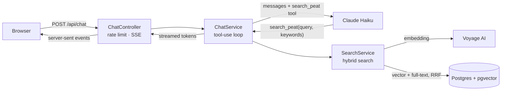

# Peatying — Ray Peat's ideas, in Spanish

**[peatying.com](https://peatying.com)** · Ask in Spanish about the ideas of biologist Ray Peat (1936–2022). Every answer is grounded in his original articles and cites them, with the original English text one click away.


It is a retrieval-augmented generation (RAG) app built end to end: scraping and cleaning the corpus, hybrid search in Postgres, an agentic tool-use loop with Claude, streaming answers, an evaluation harness, and a production deployment on AWS.

## Results

The point of RAG here is faithfulness: the bot should only attribute to Peat what he actually wrote. I measured it against the same model answering without retrieval. An LLM judge splits every answer into claims attributed to Peat and checks each one against the passages of the corpus most related to *that claim* (not just what the bot retrieved, to avoid grading the bot with its own evidence).

| 30 hand-written questions | Claims | Supported | Unsupported | Contradicted |
|---|---|---|---|---|
| **With RAG** | 202 | **198 (98 %)** | 4 | 0 |
| Claude without RAG | 198 | 144 (73 %) | 47 | 7 |

Example: without RAG, Claude says Peat saw lactic acid as "a useful fuel". Peat wrote the opposite: *"I have begun thinking of lactic acid as a toxin."*

A cheaper rule-based test suite (expected sources cited, literal quotes that really exist in the corpus, admitting when Peat never covered a topic, refusing off-topic questions) runs on every prompt change: **30/30** on the current production prompt, 0 invented quotes, ~$0.03 per run. Details in [`eval/RESULTS.md`](eval/RESULTS.md).

## How it works



1. **Ingestion.** A Jsoup scraper downloads the 78 articles from raypeat.com, handling two HTML layouts, a Windows-1252 charset, broken characters, epigraphs mistaken for titles and bibliographies. Text is split into ~1,500-character chunks on paragraph boundaries and embedded with Voyage AI (`voyage-4`, 1024 dims). Re-indexing is incremental: unchanged articles keep their embeddings.
2. **Hybrid search.** One SQL query combines pgvector cosine distance (meaning, works across languages) with Postgres full-text search (exact terms like "pregnenolone"), merged with Reciprocal Rank Fusion.
3. **Agentic answer.** Claude gets the question and a `search_peat` tool. It rewrites the question in English, picks keywords, and may search again from another angle (max 3 searches), then answers in Spanish citing passages as `[n]`. The loop is written by hand against the Messages API, not a framework.
4. **Streaming.** Tokens are streamed to the browser over server-sent events from virtual threads; the frontend renders markdown live and turns `[n]` into buttons that open the original passage.
5. **Conversations.** Follow-up questions use the last turns stored server-side (the client is never trusted with history). Users can select part of an answer and ask to clarify it.

## Stack

- **Backend:** Java 21, Spring Boot 4, JdbcClient (plain SQL), Flyway, anthropic-java SDK
- **Data:** PostgreSQL 17 + pgvector, Voyage AI embeddings
- **LLM:** Claude Haiku 5.5 (answers), Claude Sonnet 5.5 (evaluation judge)
- **Frontend:** vanilla HTML/CSS/JS, no framework — streaming renderer, light/dark themes
- **Infra:** AWS EC2 (ARM, Docker Compose) + RDS Postgres, Caddy for HTTPS, ECR, SSM Parameter Store for secrets, deploys via SSM Run Command (no SSH), CloudWatch logs

## Problems worth telling

- **The Spanish translation won every search.** raypeat.com hosts a few translations; with multilingual embeddings, a Spanish question matched the one Spanish article regardless of topic. Removed them, and made full-text keywords English-only.
- **The judge graded the bot with its own evidence.** The first judge only saw what the bot had retrieved, so unsupported claims looked supported. Switched to per-claim evidence searched across the whole corpus.
- **The bot retracted true statements.** In a follow-up it no longer sees earlier sources, so when a new search didn't find a fact it "corrected" itself. Fixed in the prompt and verified with repeated runs.
- **Users kept seeing old versions.** Every file inside a Spring Boot jar has the same 1980 timestamp, so `Last-Modified` caching never invalidated. Replaced with content-based ETags.
- **Rate limiting was bypassable.** `X-Forwarded-For` is client-controlled; the real IP is taken only behind our own proxy, and only the last hop.
- **Costs are bounded by design:** per-IP and global daily limits, request size capped at the proxy, and a provider-side spend limit.

## Security and privacy

Content-Security-Policy and other security headers, HSTS, no SSH (port 22 closed), private encrypted database, least-privilege IAM role, secrets only in SSM. No IPs are stored: visitors are counted with a daily-salted anonymous hash, and logs expire after 30 days.

## Run locally

Requirements: Java 21, Docker, a Voyage AI key and an Anthropic key in the environment variables `VOYAGE_API_KEY` and `ANTHROPIC_API_KEY`.

```bash
docker compose up -d                      # Postgres + pgvector
./mvnw package -DskipTests
java -jar target/rag-peat-0.0.1-SNAPSHOT.jar download   # scrape the articles into data/
java -jar target/rag-peat-0.0.1-SNAPSHOT.jar index      # chunk them into Postgres
java -jar target/rag-peat-0.0.1-SNAPSHOT.jar embed      # compute embeddings
java -jar target/rag-peat-0.0.1-SNAPSHOT.jar            # web app on http://localhost:8080
```

Other commands: `search "<query>" "<keywords>"`, `ask "<question>"`, `eval` (rule-based suite), `compare` (RAG vs no RAG with the LLM judge), `stats` (usage metrics).

## Notes

Independent, non-commercial project, not affiliated with Ray Peat or raypeat.com. The articles are not stored in this repository: they are downloaded from raypeat.com, and every answer links back to the original. Answers may contain errors and are not medical advice.
