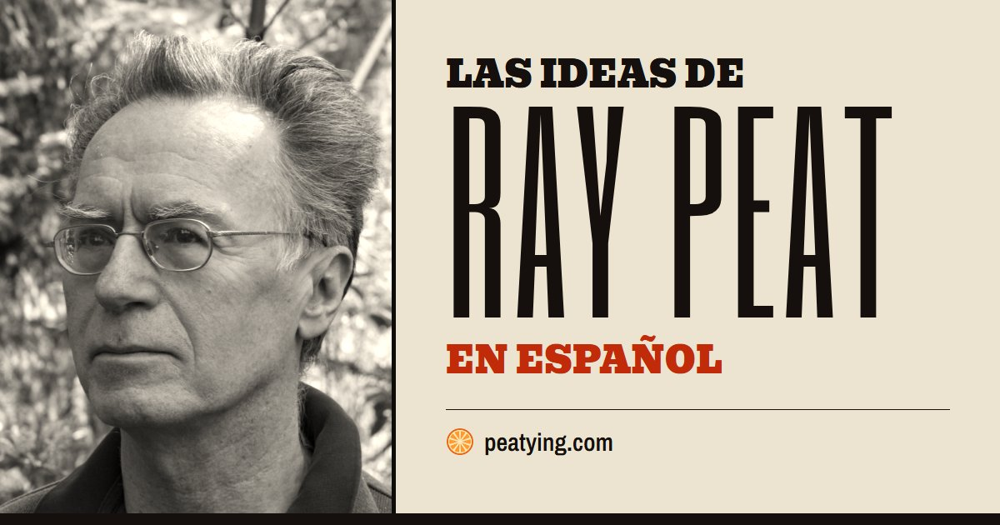
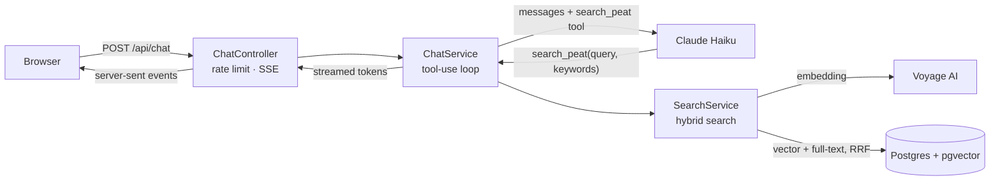

# Peatying — Ray Peat's ideas, in Spanish

**[peatying.com](https://peatying.com)** · A Spanish chatbot about the ideas of biologist Ray Peat (1936–2022). Every answer is grounded in his own words — 78 articles and 221 radio interviews — and cites them, with the original text and audio one click away.



A retrieval-augmented generation (RAG) app built and run end to end by one developer: corpus scraping, an audio transcription pipeline with speaker attribution, hybrid search in Postgres, an agentic tool-use loop with Claude, streaming answers, an evaluation harness, privacy-first analytics, SEO, and a production deployment on AWS.

## Results

The point of RAG here is faithfulness: the bot should only attribute to Peat what he actually said. I measured it against the same model answering without retrieval. An LLM judge splits every answer into claims attributed to Peat and checks each one against the passages of the corpus most related to *that claim* (not just what the bot retrieved, to avoid grading the bot with its own evidence).

| 30 hand-written questions (articles only) | Claims | Supported | Unsupported | Contradicted |
|---|---|---|---|---|
| **With RAG** | 202 | **198 (98 %)** | 4 | 0 |
| Claude without RAG | 198 | 144 (73 %) | 47 | 7 |

Example: without RAG, Claude says Peat saw lactic acid as "a useful fuel". Peat wrote the opposite: *"I have begun thinking of lactic acid as a toxin."*

A cheaper rule-based suite runs on every prompt change: expected sources cited, literal quotes that really exist in the corpus (and never from automatic transcripts), admitting when Peat never covered a topic, refusing off-topic questions. Latest run: **33/34**, ~$0.03. Details in [`eval/RESULTS.md`](eval/RESULTS.md).

## How it works



1. **Articles.** A Jsoup scraper downloads the 78 articles from raypeat.com, handling two HTML layouts, a Windows-1252 charset, broken characters, epigraphs mistaken for titles and bibliographies. Text is split into ~1,500-character chunks on paragraph boundaries and embedded with Voyage AI (`voyage-4`, 1024 dims). Re-indexing is incremental.
2. **Interviews.** ~250 hours of public radio and podcast audio, transcribed by my own pipeline (below). Chunks keep who is speaking, and only Peat's words count as his opinion.
3. **Hybrid search.** One SQL query combines pgvector cosine distance (meaning, works across languages) with Postgres full-text search (exact terms like "pregnenolone"), merged with Reciprocal Rank Fusion, with a per-type quota (3 articles + 2 interviews per 5 results) so the written work is never crowded out.
4. **Agentic answer.** Claude gets the question and a `search_peat` tool. It rewrites the question in English, picks keywords, may search again from another angle (max 3 searches), then answers in Spanish citing passages as `[n]`. The loop is written by hand against the Messages API, not a framework.
5. **Streaming.** Tokens are streamed over server-sent events from virtual threads; the frontend renders markdown live and turns `[n]` into buttons that open the original passage, which can be translated to Spanish on demand.

### Transcription pipeline


Sonnet never rewrites the text: it only returns ranges of sentence numbers per speaker, which are validated to cover every sentence exactly once, so transcripts stay verbatim. Show-specific hints help with hard cases (a co-host who also explains biology at length). 224 episodes, ~250 h of audio, ~$27 in total. Haiku, gpt-oss and Qwen were tried first and misattributed turns or broke the output format.

## Product

- **Chat** with follow-up questions, "clarify this" on any selected fragment, conversation history kept in the browser (rename, delete, resume), Markdown download.
- **20 topic pages** (`/temas`) generated from the same sources with Sonnet, reviewed by hand, with FAQ and schema.org data — static text that search engines and AI assistants can read, unlike chat answers.
- **Shareable answers** (`/r/<id>`): a server-side copy with link previews for WhatsApp/Telegram.
- **Feedback**: 👍/👎 per answer with an optional "what went wrong".
- **Private dashboard** (`/panel`): visits, origins, approximate locations, cost, votes and every conversation with search — behind a secret token kept in SSM Parameter Store.
- **SEO**: sitemap, canonical URLs, structured data, IndexNow pings, Google Search Console and Bing Webmaster Tools.

## Stack

- **Backend:** Java 21, Spring Boot 4, JdbcClient (plain SQL), Flyway, anthropic-java SDK
- **Data:** PostgreSQL 17 + pgvector, Voyage AI embeddings
- **LLM:** Claude Haiku 5.5 (answers, translations), Claude Sonnet 5.5 (speaker attribution, topic pages, evaluation judge), Whisper on Groq (speech to text)
- **Frontend:** vanilla HTML/CSS/JS, no framework — streaming renderer, self-hosted fonts, strict CSP
- **Infra:** AWS EC2 (ARM, Docker Compose) + RDS Postgres, Caddy for HTTPS, ECR, SSM Parameter Store for secrets, deploys via SSM Run Command (no SSH), CloudWatch logs

## Problems worth telling

- **The Spanish translation won every search.** raypeat.com hosts a few translations; with multilingual embeddings, a Spanish question matched the one Spanish article regardless of topic. Removed them, and made full-text keywords English-only.
- **The judge graded the bot with its own evidence.** The first judge only saw what the bot had retrieved, so unsupported claims looked supported. Switched to per-claim evidence searched across the whole corpus.
- **The bot retracted true statements.** In a follow-up it no longer sees earlier sources, so when a new search didn't find a fact it "corrected" itself. Fixed in the prompt and verified with repeated runs.
- **Two speakers who both explain biology.** On one podcast the co-host talks about hormones as much as Peat. A per-show hint plus a check for third-person mentions of Peat inside his own turns found 9 suspicious turns out of 2,182, almost all false alarms.
- **A personal-data filter that ate a sentence.** Users paste lab reports with ID numbers into the chat, so messages are redacted before storage. The first version took "Energía celular:" (cell energy) for a phone label ("celular" = mobile phone). Everyday words now only count as labels at the start of a line, with tests for bot answers.
- **Users kept seeing old versions.** Every file inside a Spring Boot jar has the same 1980 timestamp, so `Last-Modified` caching never invalidated. Replaced with content-based ETags — which in turn returned empty bodies on forwarded clean URLs, so those are excluded.
- **Rate limiting was bypassable.** `X-Forwarded-For` is client-controlled; the real IP is taken only behind our own proxy, and only the last hop.
- **Costs are bounded by design:** per-IP and global daily limits, request size capped at the proxy, separate limits for translations, shares and visits, and provider-side spend limits.

## Security and privacy

Content-Security-Policy and other security headers, HSTS, no SSH (port 22 closed), private encrypted database, least-privilege IAM role, secrets only in SSM. Public pages built from user actions (shared answers) only contain text read from the database and sources verified against the corpus, never what the browser sends.

No IPs are stored. Visitors are counted with a daily-salted anonymous hash; approximate country and city come from an offline DB-IP database on the server, so the IP never leaves it. Questions are stored with ID numbers, birth dates, record numbers, emails and phones redacted, and deleted after 12 months by a nightly job. No cookies; the chat history lives only in the user's browser.

## Run locally

Requirements: Java 21, Docker, and `VOYAGE_API_KEY` and `ANTHROPIC_API_KEY` in the environment (plus `GROQ_API_KEY` to transcribe).

```bash
docker compose up -d                      # Postgres + pgvector
./mvnw package -DskipTests
java -jar target/rag-peat-0.0.1-SNAPSHOT.jar download          # scrape the articles into data/
java -jar target/rag-peat-0.0.1-SNAPSHOT.jar index             # chunk them into Postgres
python scripts/transcribe_interviews.py urls.txt               # transcribe interviews into data/transcripts/
java -jar target/rag-peat-0.0.1-SNAPSHOT.jar index-interviews  # chunk the transcripts
java -jar target/rag-peat-0.0.1-SNAPSHOT.jar embed             # compute embeddings
java -jar target/rag-peat-0.0.1-SNAPSHOT.jar                   # web app on http://localhost:8080
```

Other commands: `search "<query>" "<keywords>"`, `ask "<question>"`, `eval` (rule-based suite), `compare` (RAG vs no RAG with the LLM judge), `topics` (generate topic pages), `stats` (usage metrics), `redact` (re-run the personal-data filter on stored messages).

## Notes

Independent, non-commercial project, not affiliated with Ray Peat or raypeat.com. Articles and audio are not stored in this repository: they are downloaded from their public sources, and every answer links back to the original. Answers may contain errors and are not medical advice.
